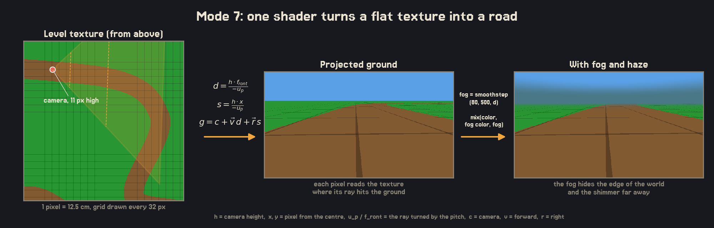
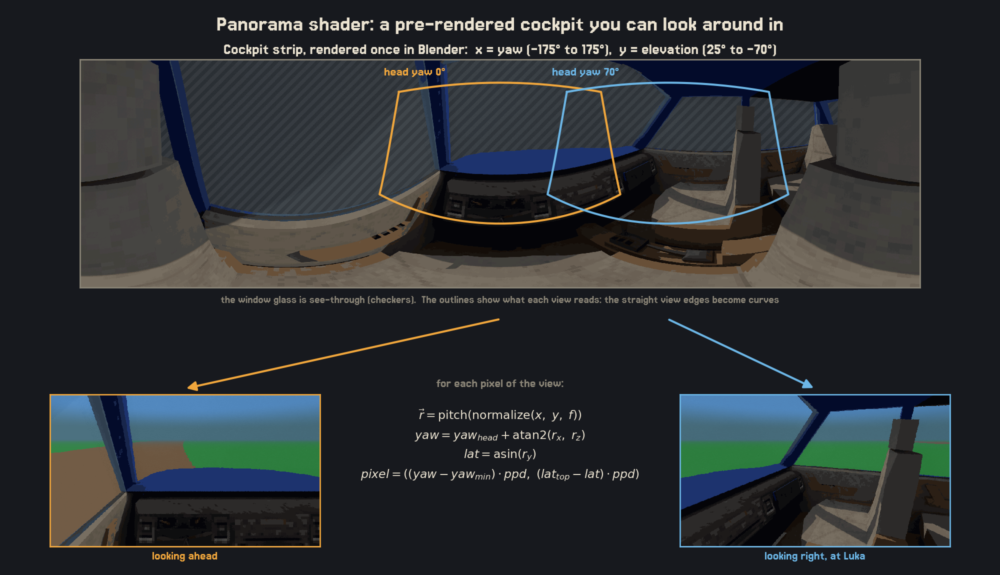
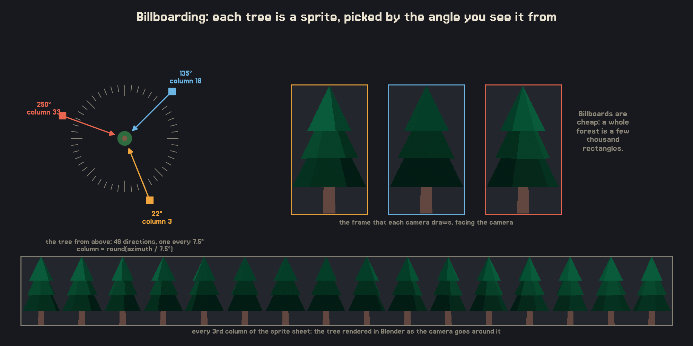
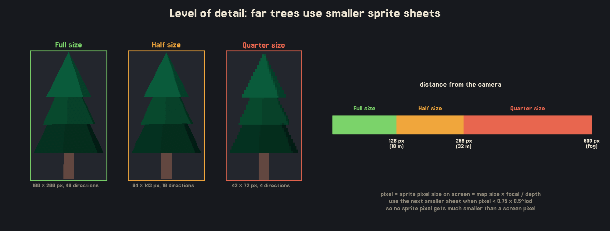
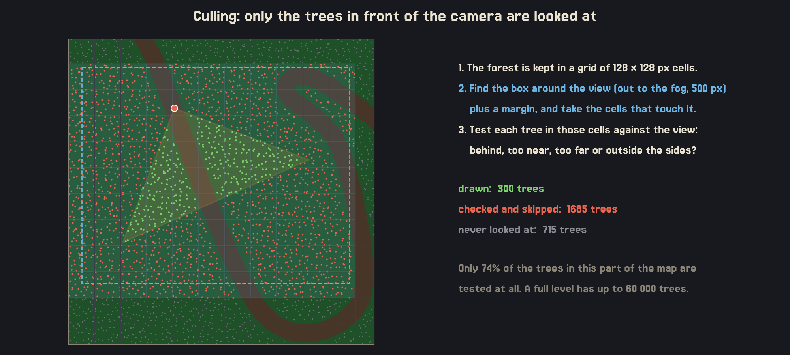
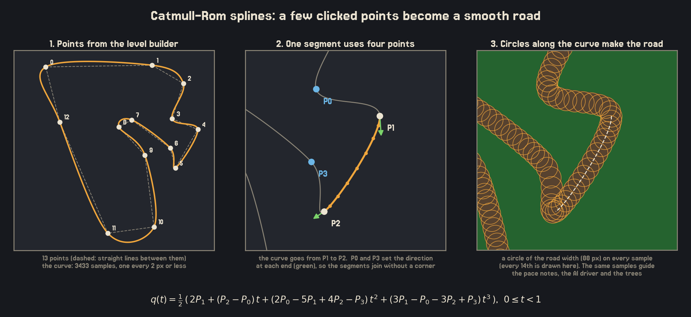
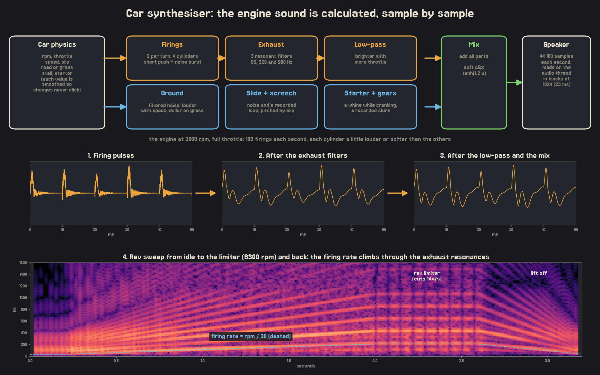

# Holy Shift

> This is my submission for the Game Off 2026 Game Jam with the theme **shift**. Thank you for giving me an excuse to create my first ever game!

## Important note

The game is still in development and is not finished yet. The gamejam submission deadline is November 30th, when the full game is planned to be released.

---

The player, 78-year-old Rajka, used to be a rally racer in the 70s before falling out with her co-driver Jelka and quitting due to a **shift** in agreements. Now, due to a rapid **shift** in technology, the village's beloved bingo hall is due to be demolished to make room for a new data centre!

In her desperation, Rajka finds a poster for a rally race and she gets an idea. She must now race again to raise enough money to save her bingo hall from being **shifted** into a data centre. Her only co-driver is her 15-year-old grandson, Luka. There's just one small problem: Luka is scared of racing and gets carsick easily, so he can't look at the road while Rajka drives. All he can do is hold the map. Rajka must **shift** her attention between the road and the map while **shifting** gears.

Can she **shift** back into her old career and raise enough money to save the bingo hall? Or will the town forever be tainted by the **shift** from having their beloved bingo hall to becoming home to a loud, noisy data centre?

## Controls

| Action | Keys |
|---|---|
| Throttle | W / Up |
| Brake | S / Down |
| Steer | A / D or Left / Right |
| Shift up | E / Right mouse button |
| Shift down | Q / Left mouse button |
| Handbrake | Space |
| Look around (and at Luka's map) | Mouse |
| Restart stage | R |
| Pause | Esc |
| Fullscreen | F11 |

The Jugo 65 has a manual gearbox. Shift up before the engine hits the limiter, and shift down before tight corners. To read the pace notes, turn your head to the right and look at the map that Luka holds. While you look at the map, you can't see the road.

## Building

You need a C compiler, make and [raylib](https://www.raylib.com/) 6. The Makefiles look for raylib in `/opt/homebrew` (where Homebrew puts it on macOS). For another location, pass `RAYLIB=/path/to/raylib`.

```sh
# macOS
brew install raylib

# Build and run the game (it must run from the project root, which make run does for you)
make -C src run

# Start a level directly, or use a debug mode
make -C src run LEVEL=village_road
make -C src run ARGS=--debug_fly
```

The game is built to `build/holy_shift`. Your settings and best times are saved in `save.txt`.

### Level builder

Tracks are drawn in a separate editor that writes to `levels/<name>/`:

```sh
make -C level-builder run
```

Click to add road points, click the first point to close the loop, then pick the trees, the road width, the display name and the tutorial flag, and press Export. The controls are listed at the top of `level-builder/level_builder.c`.

---

# Technical Details

The game is written in C17 with [raylib](https://www.raylib.com/). Everything is drawn into a small 640 by 360 view, which is scaled up to the window by a whole number.

## Mode 7 Projection
The ground is a flat plane, rendered in a style similar to SNES games like F-Zero. For each pixel on the screen, a fragment shader casts a ray from the camera and calculates where it intersects the ground. It then uses that position to sample the level texture and determine the pixel's colour. Anything above the horizon is simply drawn with the sky colour.

Since the entire ground is covered by a single texture, the size of the level has no real impact on the rendering cost. Even a 2048 by 2048 level, with each pixel representing 12.5 cm, takes roughly the same amount of work to draw as a much smaller one. The fog fades out the ground in the distance, hiding both the edge of the world and the pixel shimmer that becomes noticeable at longer distances.



## Panorama Shader
The cockpit isn't a 3D model. Instead, a Blender script renders the inside of the car into a wide texture, where each column represents a different yaw angle and each row represents an elevation angle. When the game runs, a shader figures out which angle each screen pixel corresponds to based on the camera's rotation, then samples the texture at that point. This way, the cockpit changes perspective naturally as you look around, rather than just stretching a flat image. The windows are transparent, allowing the world outside to show through, and the steering wheel uses a separate set of frames that rotate along with the player's steering.



## Billboarding
The trees are flat sprites that always face the camera. A Blender script renders each tree model from 48 different directions and two different heights, with all the resulting images packed into a single sprite sheet. At runtime, each tree uses the frame that best matches the direction the camera is looking from. This gives the trees a 3D appearance as you drive past them without actually having to render 3D models. Each tree also has a dithered shadow beneath it to make it sit more naturally on the ground. Trees are drawn from furthest to nearest, so closer trees naturally cover those behind them.



## Level of Detail (LOD)
When a tree is far away, it only takes up a handful of pixels on screen. Drawing its full-size sprite at that distance is unnecessary and can also cause flickering. To avoid this, each tree has three sprite sheets: a full-size version, a half-size version with 16 viewing directions, and a quarter-size version with just 4 directions. The game chooses which one to use based on how large the tree appears on screen. The smaller versions are generated from the original sprites using a Python script, while keeping the same colour palette.



## Culling
A level can contain tens of thousands of trees, so there's no point in processing all of them every frame. Instead, the forest is divided into a grid of cells, and the game only checks the ones near the camera and within the fog distance. It then checks the trees in those cells to see if they're actually visible. Trees behind the camera, outside the edges of the view, too close to render properly, or hidden by fog are simply skipped.



## Catmull-Rom Splines
A track starts with just a handful of points placed in the level builder. Village Road, for example, only uses 13. The game connects these points using a Catmull-Rom spline to create a smooth road. Each section of the curve runs between two points, P1 and P2, while also taking the previous point (P0) and the next point (P3) into account. These extra points determine the direction the curve takes as it enters and leaves each section. This keeps neighbouring sections aligned, avoiding sharp corners where they meet. Unlike some other spline types, a Catmull-Rom spline passes directly through every point, so the road follows the points placed in the editor.

The curve is sampled at intervals of no more than 2 map pixels (25 cm). When a level is exported, the builder draws a circle with the road's width at every sample point, effectively painting the road into the logic map. The game generates the same samples again when loading the level. These are then used for several things: calculating the total stage distance, generating the pace notes on Luka's map based on how sharply the road turns, guiding the self-driving car, and keeping trees from spawning on the road.



## Car Synthesiser
The engine sound isn't made up of recorded audio. Instead, it's generated in real time from the car's physics, one sample at a time at 44,100 samples per second. raylib handles the audio on a separate thread, calling the synthesiser in blocks of 1024 samples (roughly 23 ms). The game passes it the current engine and car values through atomic variables: rpm, throttle, speed, wheel slip, whether the car is on road or grass, stall state and starter state. These values are smoothed inside the synthesiser to prevent sudden changes from causing clicks.

The engine sound is built around the same basic idea as a real combustion engine:

1. **Firings.** A four-stroke, four-cylinder engine fires twice per crankshaft revolution, giving a firing rate of rpm / 30. At 3000 rpm, that's 100 firings per second. Each firing produces a short pressure pulse followed by a burst of noise. The cylinders each have slightly different volumes, and every firing gets a bit of random variation. This gives the engine its uneven character instead of making it sound like a simple buzzer.
2. **Exhaust.** The pulses pass through three resonant band-pass filters at 95, 320 and 900 Hz. Each filter adds a different part of the exhaust sound, from the deeper body to the sharper bark and rasp. The rasp becomes more noticeable as the throttle increases.
3. **Filtering and engine behaviour.** A low-pass filter controls how much high-frequency sound comes through. It opens up as the throttle increases, making the engine sound brighter under load. A few extra behaviours add more character:
   - At idle, the rpm slowly fluctuates.
   - At low rpm under load, the engine starts to shudder.
   - As the engine stalls, some firings are missed.
   - At 6300 rpm, the rev limiter cuts the engine 14 times per second.
   - During startup, the starter motor produces its own whine.

The tyres have their own sounds:
- Road noise gets louder with speed and becomes duller on grass.
- Sliding produces an additional hiss.
- A recorded screech loop plays when the tyres lose grip, with its pitch increasing alongside the wheel slip.

Gear changes trigger a recorded clunk. All the sounds are mixed together and passed through a `tanh` soft-clipping function to keep loud moments from producing harsh distortion.

As the engine revs higher, the firing rate and its harmonics move through the exhaust filters' fixed resonant frequencies. This is what creates the familiar rising engine note. The spectrogram at the bottom of the diagram shows this happening.



The synthesiser has since been turned into its own library: [gj26-cs](https://github.com/lassedtu/gj26-cs).

---

# Credits
- **Ana Bevanda**: Massive help with the story, direction, playtesting and character names
- **Baka Rajka & Jelica**: Letting me borrow their names, to tell my weird story
- **Engine**: [raylib](https://www.raylib.com/) by Ramon Santamaria and contributors (zlib licence)
- **Font**: [Jersey 15](https://github.com/scfried/soft-type-jersey) by The Soft Type Project Authors (SIL Open Font License 1.1)
- **UI**: [Pixel UI Pack](https://kenney.nl/assets/pixel-ui-pack) by Kenney (CC0)
- **Trees**: Low Poly Trees by [Iron Heart](https://evilempires23.itch.io/) (CC0)
- **Car cockpit**: Retro Car by [Bricchi Games](https://bricchi-games.itch.io/) (Creative Commons, attribution required)
- **Sound effects**: car crash, tyre screech and gear select recordings from [freesound.org](https://www.freesound.org)
- **Story photos**: stock photos from [Pexels](https://www.pexels.com/), pixelated by me
